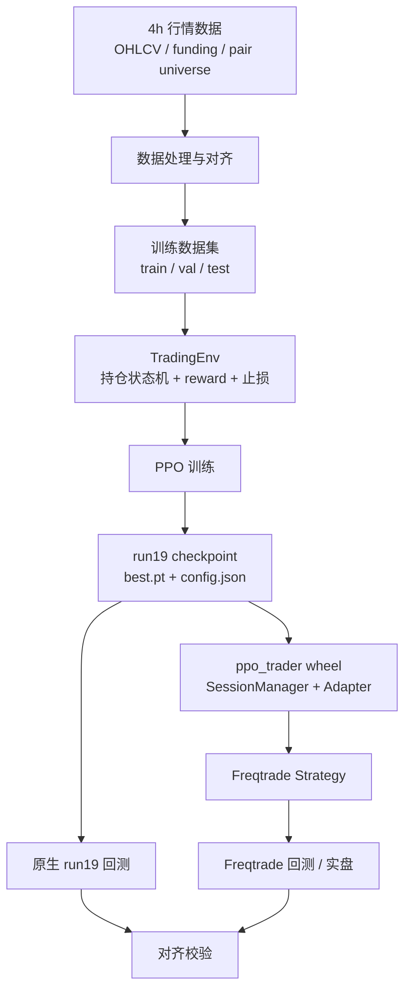
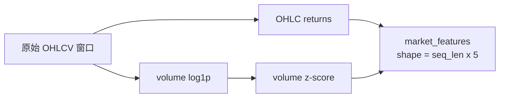
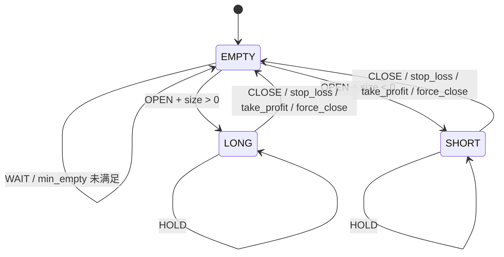
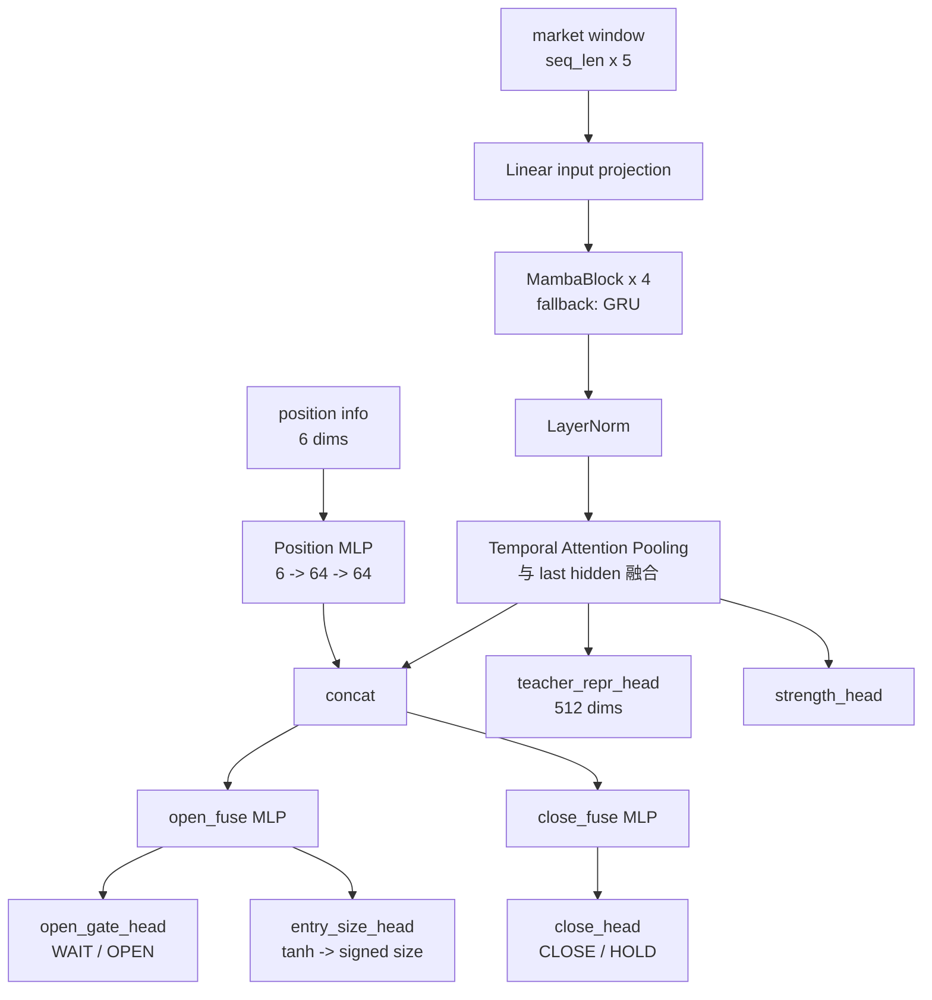
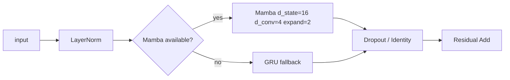
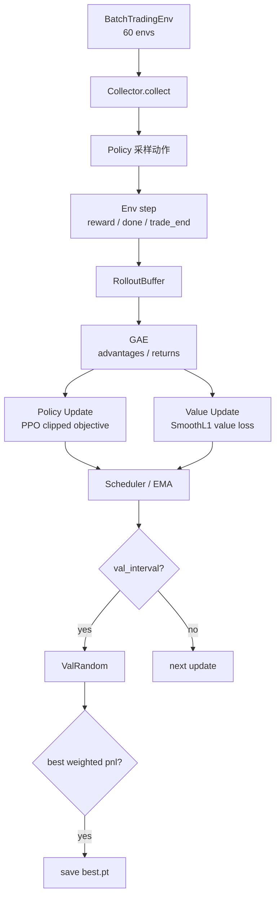
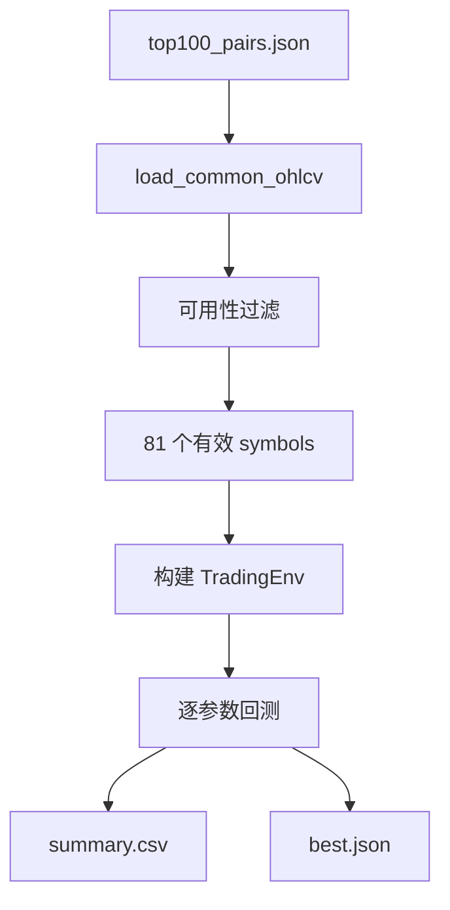
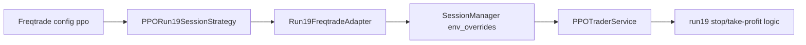
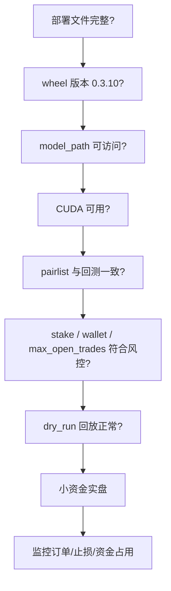
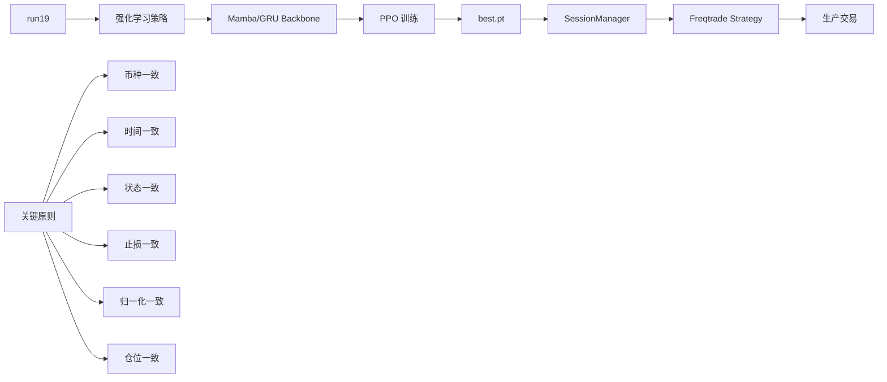

# Run19 模型训练、回测与 Freqtrade 应用培训稿

版本日期：2026-05-20  
适用代码库：`bigmodel` 当前 run19 / `ppo_trader` wheel / `PPORun19SessionStrategy`

## 1. 培训目标

这份材料用于讲清楚 run19 从数据、模型、训练、原生回测，到 Freqtrade 生产应用的完整链路。

核心结论：

- run19 是一个端到端 PPO 交易模型，不是传统指标策略。
- 模型输入是最近一段 4h OHLCV 序列和当前仓位状态。
- 模型输出分两种状态：空仓时决定是否开仓及方向/仓位；持仓时决定继续持有或平仓。
- 原生回测和 Freqtrade 必须共享同一个会话管理、状态机、归一化、止损和仓位逻辑，否则结果会大幅偏离。
- 当前生产建议参数来自止损扫描最优结果：固定止损 `-25%`，不设止盈。

## 2. 系统全貌



## 3. 关键文件

| 模块 | 文件 | 作用 |
|---|---|---|
| 训练主程序 | `train_e2e_ppo.py` | PPO 训练、TradingEnv、StudentPolicy、StudentValue、Collector、checkpoint |
| 训练配置 | `configs/e2e_ppo_run19_sl15_valrandom_seq180.json` | run19 训练/回测口径配置 |
| 模型 checkpoint | `checkpoints/ppo_e2e_run19_sl15_valrandom/best.pt` | 生产使用的策略网络权重 |
| checkpoint 配置 | `checkpoints/ppo_e2e_run19_sl15_valrandom/config.json` | 模型目录配置，wheel 加载时会读取 |
| wheel 模型 | `ppo_trader/ppo_trader/model.py` | 生产推理版 StudentPolicy |
| wheel 服务 | `ppo_trader/ppo_trader/service.py` | 归一化、推理、状态、止损、执行动作 |
| 会话管理 | `ppo_trader/ppo_trader/session.py` | 每个交易对独立会话 |
| Freqtrade adapter | `ppo_trader/ppo_trader/freqtrade_adapter.py` | 把 run19 会话转换成 Freqtrade 信号和回调 |
| Freqtrade 策略 | `user_data/strategies/PPORun19SessionStrategy.py` | 生产策略入口，只调用 wheel |
| Freqtrade 配置参考 | `config_compare_202509_202605.json` | 回测配置，生产只参考 `ppo` 参数和 pairlist |
| 止损扫描 | `scan_run19_stoploss_grid.py` | 对齐币种、时间段后扫描止损参数 |
| 对齐比较 | `compare_run19_native_vs_freqtrade_202509_202605.py` | 原生 run19 与 Freqtrade 的差异分析 |

## 4. 数据与特征

run19 当前使用 4h 级别行情。核心市场输入是 5 维：

- `open`
- `high`
- `low`
- `close`
- `volume`

生产推理和训练都使用最近 `seq_length` 根 K 线作为市场窗口。当前 Freqtrade 策略固定：

```python
SEQ_LEN = 180
timeframe = "4h"
```

注意：生产策略会把 `seq_length=180` 显式传给 `Run19FreqtradeAdapter`，由 adapter 继续传给 `SessionManager` 和 `PPOTraderService`。即使 checkpoint 配置里记录过其他长度，生产回放口径仍以策略传入值为准。

### 4.1 特征归一化

生产 wheel 里的归一化逻辑在 `PPOTraderService._normalize_returns`：

- OHLC 使用相邻 bar 的 return：
  - `return[t] = (price[t] - price[t-1]) / price[t-1]`
- Volume 使用 `log1p(volume)` 后做 z-score。
- 归一化在每个会话的滚动窗口内完成。



## 5. 交易环境与状态机

run19 不是每根 K 线独立判断，而是一个带状态的环境。模型每次推理都要知道当前仓位状态。

### 5.1 状态

| 状态 | 含义 |
|---|---|
| `EMPTY = 0` | 空仓 |
| `LONG = 1` | 多单持仓 |
| `SHORT = 2` | 空单持仓 |

### 5.2 仓位信息 6 维

`get_position_info()` 输出 6 维：

| 维度 | 含义 |
|---|---|
| 0 | 当前仓位大小，空仓为 0 |
| 1 | 当前浮盈浮亏，经 `tanh` 缩放 |
| 2 | 持仓以来 peak return，经 `tanh` 缩放 |
| 3 | 从 peak 回撤，经 `tanh` 缩放 |
| 4 | 空仓步数或持仓步数归一化 |
| 5 | 距离 peak 的步数归一化 |

### 5.3 动作空间

模型动作是“两阶段”设计。

空仓时：

| 输出 | 含义 |
|---|---|
| `WAIT = 0` | 继续空仓 |
| `OPEN = 1` | 开仓 |
| `size ∈ [-1, 1]` | 正数开多，负数开空，绝对值表示模型仓位强度 |

持仓时：

| 输出 | 含义 |
|---|---|
| `CLOSE = 0` | 平仓 |
| `HOLD = 1` | 继续持有 |



### 5.4 交易执行规则

训练原生环境中，动作发生在当前 step，对应当前 bar：

- 开仓价格：当前 bar 的 `open`。
- 模型主动平仓价格：当前 bar 的 `open`。
- 止损触发：
  - 多单：先看 `bar_open <= stop_px`，再看 `bar_low <= stop_px`。
  - 空单：先看 `bar_open >= stop_px`，再看 `bar_high >= stop_px`。
- 如果触发止损，不直接按 low/high 成交，而是按止损价附近成交：
  - 跳空穿越止损时用 open。
  - 盘中触发时用 stop price。

这是对齐 Freqtrade 的关键点：low/high 只负责触发，不应该作为最终成交价。

## 6. 模型架构

run19 的策略网络和价值网络都基于 Mamba/GRU backbone。

### 6.1 策略网络 StudentPolicy

训练版 `StudentPolicy` 位于 `train_e2e_ppo.py`。生产推理版位于 wheel 的 `ppo_trader/ppo_trader/model.py`。

当前主要配置：

| 参数 | 值 |
|---|---|
| 输入维度 | 5 |
| hidden_dim | 256 |
| num_layers | 4 |
| position_dim | 64 |
| asset_embed | 当前 `use_asset_ids=false`，不使用资产 embedding |
| temporal attention | 开启 |
| action head | open gate / entry size / close head |
| teacher repr head | 512 维 |



### 6.2 MambaBlock

每层结构：



### 6.3 Value Network

`StudentValue` 用相似 backbone，但输出一个 state value：

```mermaid
flowchart TD
    A[market window] --> B[MambaBackbone]
    C[position info] --> D[Position MLP]
    B --> E[concat]
    D --> E
    E --> F[Value Head MLP]
    F --> G[V(s)]
```

## 7. 训练流程

训练主入口：

```bash
python train_e2e_ppo.py --config configs/e2e_ppo_run19_sl15_valrandom_seq180.json
```

### 7.1 训练配置摘要

| 类别 | 当前关键配置 |
|---|---|
| 数据 | 4h，`seq_length=180`，returns 归一化 |
| 环境 | 手续费 `0.001` 单边，`max_holding_steps=40`，`min_holding_steps=3` |
| 止损 | 训练配置里默认 ATR 止损：`stop_loss_vol_multiple=1.5`，不设止盈 |
| PPO | `max_updates=2000`，`envs_per_batch=60`，`trajectory_length=150` |
| 优化 | policy lr `4e-5`，value lr `1e-4`，AdamW |
| 设备 | policy/value 可分 GPU：例如 `cuda:1` / `cuda:0` |
| Teacher | Kron representation distillation，repr dim 512 |
| EMA | `policy_ema_decay=0.999` |

### 7.2 PPO 采样与更新



### 7.3 Loss 组成

策略 loss：

- PPO clipped objective。
- entropy bonus。
- direction balance penalty，避免方向严重偏置。
- teacher action KL，可选。
- teacher strength loss，可选。
- teacher representation cosine loss，当前 run19 主要使用 representation distillation。

价值 loss：

- `SmoothL1Loss(V(s), returns) * value_loss_coef`

### 7.4 Reward 设计

reward 主要由三部分组成：

| reward | 来源 |
|---|---|
| open_reward | 开仓时扣双边手续费 |
| hold_reward | 持仓期间基于收益和回撤的 potential shaping |
| close_reward | 平仓时结算实际收益 |

持仓 reward 会用近期波动率归一化，避免高波动资产天然 reward 过大。

## 8. 原生 run19 回测

原生回测直接使用 `TradingEnv` 和 `StudentPolicy`，不经过 Freqtrade。

常用入口：

- `scan_run19_stoploss_grid.py`：扫描止损参数。
- `compare_run19_native_vs_freqtrade_202509_202605.py`：对比原生 run19 与 Freqtrade。

### 8.1 止损扫描

止损扫描会做这些事：

1. 读取同一组 pair。
2. 根据本地 Freqtrade futures 数据过滤可用币种。
3. 构建 run19 native 环境。
4. 对固定止损和 ATR 止损做网格扫描。
5. 按账户收益排序，输出 summary 和 best。



当前最优扫描结果：

| 指标 | 值 |
|---|---:|
| label | `fixed_0.25_tp_0` |
| stop_loss | `-0.25` |
| stop_loss_vol_multiple | `0.0` |
| take_profit | `0.0` |
| symbols | `81` |
| trades | `4588` |
| win_rate | `85.22%` |
| account_roi_pct | `33.120965%` |

## 9. Freqtrade 应用架构

Freqtrade 策略不直接实现模型逻辑，只做入口。真实逻辑在 wheel。

```mermaid
flowchart TD
    A[Freqtrade Backtesting / Live] --> B[PPORun19SessionStrategy]
    B --> C[_import_ppo_trader_wheel]
    C --> D[Run19FreqtradeAdapter]
    D --> E[SessionManager]
    E --> F[TradingSession per pair]
    F --> G[PPOTraderService]
    G --> H[StudentPolicy.load(best.pt)]
    G --> I[归一化 / position state / action mask]
    H --> J[deterministic action]
    I --> J
    J --> K[run19 execute_action]
    K --> L[Freqtrade enter/exit/custom_stoploss/custom_stake]
```

### 9.1 为什么必须用 wheel

生产策略里 `_import_ppo_trader_wheel()` 会强制从 `site-packages` 导入 `ppo_trader`，避免误用项目源码目录。

这样做的原因：

- 生产环境只依赖稳定 wheel 包。
- Freqtrade 策略更薄，容易部署。
- run19 会话管理、止损、状态、归一化统一封装在 wheel，避免策略文件里复制逻辑。

### 9.2 Freqtrade 策略回调

| Freqtrade 方法 | run19 对应逻辑 |
|---|---|
| `populate_indicators` | 调用 adapter 生成并缓存信号 |
| `populate_entry_trend` | 写入 `enter_long / enter_short` |
| `populate_exit_trend` | 写入 `exit_long / exit_short` |
| `custom_exit` | 用 adapter 返回 run19 的退出原因 |
| `custom_exit_price` | 用 run19 记录的退出价 |
| `custom_stoploss` | 把 run19 stop price 转成 Freqtrade stoploss ratio |
| `custom_stake_amount` | 按模型输出仓位强度计算 stake |
| `leverage` | 当前固定 1x |

### 9.3 生产参数

生产配置中必须包含 `ppo` 段：

```json
"ppo": {
  "model_path": "checkpoints/ppo_e2e_run19_sl15_valrandom/best.pt",
  "device": "cuda",
  "base_stake": 1000,
  "stop_loss": -0.25,
  "stop_loss_vol_multiple": 0.0,
  "take_profit": 0.0
}
```

这些参数会传入 wheel：



## 10. 原生回测与 Freqtrade 对齐结果

本次对齐回测：

| 项目 | 值 |
|---|---:|
| 回测区间 | `2025-09-01 00:00:00` 到 `2026-05-13 16:00:00` |
| pair whitelist | 100 |
| Freqtrade 有效可交易币种 | 81 |
| 模型 | `checkpoints/ppo_e2e_run19_sl15_valrandom/best.pt` |
| 参数 | `fixed_0.25_tp_0` |
| Freqtrade trades | 4584 |
| Freqtrade win rate | 85.12% |
| Freqtrade total profit | 33.11% |
| Freqtrade CAGR | 50.84% |
| Freqtrade max account drawdown | 6.66% |

对齐结果：

| 回测方式 | 账户收益 |
|---|---:|
| native run19 scan | 33.120965% |
| Freqtrade | 33.114455% |
| 差异 | 约 0.0065% |

这个差异已经接近可接受的数值/撮合误差范围。

## 11. 生产部署文件

最小部署包：

| 文件 | 说明 |
|---|---|
| `user_data/strategies/PPORun19SessionStrategy.py` | Freqtrade 策略文件 |
| `ppo_trader/dist/ppo_trader-0.3.10-py3-none-any.whl` | wheel 包 |
| `checkpoints/ppo_e2e_run19_sl15_valrandom/best.pt` | 模型权重 |
| `checkpoints/ppo_e2e_run19_sl15_valrandom/config.json` | 模型目录配置 |
| 生产 Freqtrade config | 包含 exchange、pairlist、wallet、`ppo` 参数 |

安装 wheel：

```bash
pip install --force-reinstall --no-deps ppo_trader-0.3.10-py3-none-any.whl
```

验证 wheel：

```bash
python -c "import ppo_trader; print(ppo_trader.__file__); print(ppo_trader.__version__)"
```

预期版本：

```text
0.3.10
```

## 12. 实盘前检查清单



检查项：

- `ppo_trader.__file__` 必须指向生产虚拟环境的 `site-packages`。
- 策略目录里不要放本地 `ppo_trader` 源码目录，避免 shadow import。
- `model_path` 指向的目录必须同时有 `best.pt` 和 `config.json`。
- `ppo.stop_loss=-0.25`、`ppo.stop_loss_vol_multiple=0.0`、`ppo.take_profit=0.0` 必须写入生产配置。
- `max_open_trades` 建议不低于有效币种数，否则会改变资金利用和交易选择。
- 生产前先跑 dry-run，确认：
  - strategy 能加载 wheel；
  - GPU 能被 torch 识别；
  - 有 enter/exit 信号；
  - stoploss 触发价不是 low/high 成交价，而是 stop price 附近。

## 13. 常见问题

### 13.1 为什么原生 run19 和 Freqtrade 曾经差异很大？

主要原因不是模型不同，而是执行层不一致：

- 币种集合没有完全对齐。
- Freqtrade 和原生 run19 的持仓状态不同步。
- 止损触发和止损成交价处理不同。
- 归一化窗口、`seq_length`、缓存口径不同。
- stake 没按模型输出仓位强度还原。

现在通过 wheel 里的 `SessionManager` 和 `Run19FreqtradeAdapter` 统一了这些逻辑。

### 13.2 为什么训练时 ATR 止损，但生产用固定 25%？

训练配置里使用 ATR 风格止损是环境训练口径。生产参数来自独立的 out-of-sample/对齐期间扫描。在 `2025-09` 到 `2026-05`、同一币种集合下，固定 `25%` 止损的账户收益最高，且 Freqtrade 已与 native 回测对齐。

### 13.3 33% 是真实账户收益还是 trade pnl 累加？

当前 Freqtrade 输出的 `33.11%` 是账户维度收益：

- 起始资金：`100000 USDT`
- 最终资金：`133114.455 USDT`
- 账户收益：`33.11%`

不是简单把每笔 trade 的百分比直接相加。

### 13.4 为什么 CAGR 是 50.84%，不是 33.11%？

回测区间不足一年。`33.11%` 是本区间实际账户收益；`50.84%` 是 Freqtrade 根据回测天数年化出来的 CAGR。培训时建议优先讲实际账户收益，再辅助讲年化。

## 14. 建议讲解顺序

1. 先讲系统全貌：数据、环境、模型、训练、回测、生产。
2. 再讲交易状态机：空仓/多/空、动作如何变化。
3. 讲模型结构：market backbone + position info + heads。
4. 讲 PPO 训练：Collector、GAE、policy/value update、teacher distillation。
5. 讲回测：原生 run19、止损扫描、参数选择。
6. 讲 Freqtrade：为什么策略薄、为什么必须走 wheel。
7. 最后讲部署清单和风控参数。

## 15. 一页总结



run19 的核心不是某个单点模型文件，而是一整套可复现的交易系统。只有当训练环境、原生回测、wheel 会话管理和 Freqtrade 策略都使用同一套状态机时，结果才可信。
